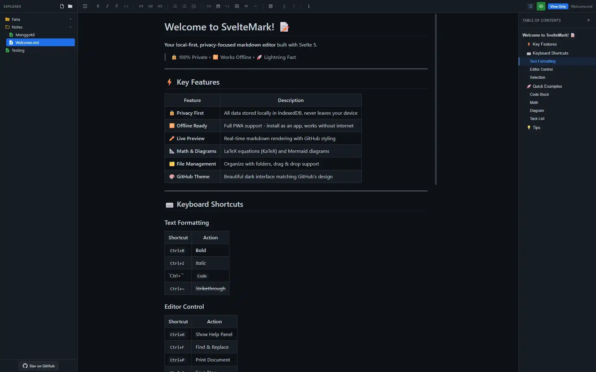

# mdman

[](https://go.dev/) [](./LICENSE) [](https://github.com/FanSoftLab/mdman/actions) [](https://goreportcard.com/report/github.com/FanSoftLab/mdman) [](https://pkg.go.dev/github.com/FanSoftLab/mdman)

**Privacy-first, local-only Markdown editor.** Desktop port of [SvelteMark](https://github.com/MasFana/sveltemark), running as a native desktop app via Wails v2 (Go + system webview).

## Demo

| Editor | Preview | Diagrams & Math |
|--------|---------|-----------------|
|  |  |  |

*Dark GitHub-style UI with CodeMirror 6, live preview, Mermaid diagrams, KaTeX math, and full GFM support.*

## Getting Started

### Quick Install (Prebuilt Binary)

1. Go to the [Releases page](https://github.com/FanSoftLab/mdman/releases)
2. Download the archive for your OS/architecture
3. Extract and run `mdman`

### Build from Source

**Prerequisites:**
- Go 1.27+
- Node.js 20+
- Wails CLI: `go install github.com/wailsapp/wails/v2/cmd/wails@latest`
- Linux: `libwebkit2gtk-4.1-dev` (or 4.0), `libgtk-3-dev`, `libayatana-appindicator3-dev`

```bash
git clone https://github.com/FanSoftLab/mdman.git
cd mdman
cd frontend && npm install && cd ..
wails dev          # Development with live reload
wails build        # Production binary in build/bin/
```

### Docker Cross-Platform Build

```bash
./build.sh                              # Current OS/arch, AppImage on Linux
./build.sh -os linux -arch amd64
./build.sh -os linux,windows -arch amd64 -v 1.0.0
./build.sh -no-appimage -no-cache
```

Requires Docker with BuildKit. Output goes to `./dist/`.

### CLI Usage

```bash
mdman file1.md file2.md    # Open files in tabs on startup
```

## Features

### Core Editing
- **CodeMirror 6** — Modern, extensible Markdown editor
- **GitHub Flavored Markdown** — Tables, task lists, strikethrough, autolinks
- **Live Preview** — Real-time rendering with GitHub Markdown CSS
- **Syntax Highlighting** — highlight.js for 180+ languages
- **Tabbed Interface** — Multiple notes, dirty indicators, keyboard navigation

### Diagrams & Math
- **Mermaid** — Flowchart, sequence, class, state, pie, gantt, gitgraph, ER, journey
- **KaTeX** — Inline `$...$` and block `$$...$$` math formulas
- **Print Dialog** — Light-theme rendering for diagrams and math

### Organization
- **Hierarchical Folders/Files** — Drag-and-drop in sidebar
- **File Operations** — New, rename, delete, download as Markdown
- **Workspace** — Root folder with persistent file tree
- **Recent Files** — Quick access panel with clear action
- **Table of Contents** — Heading navigation with sync scroll

### Productivity
- **Toolbar** — Formatting, headings, lists, code, diagrams, math, view toggles
- **Context Menu** — Right-click formatting in editor
- **Keyboard Shortcuts** — All major actions (customizable via help panel)
- **Find & Replace** — Case-sensitive, whole-word, regex options
- **Auto-hide UI** — Sidebar/toolbar hide until pointer nears edge
- **View-only Mode** — Distraction-free preview
- **Word Wrap & Sync Scroll** — Toggleable editor/preview synchronization

### Themes & Localization
- **App Theme** — Dark, light, system (window chrome + sidebar + toolbar)
- **Preview Theme** — Dark, light, system (rendered Markdown)
- **Languages** — English, Ukrainian (full UI translation)

### Data & Portability
- **IndexedDB Storage** — Notes live in browser storage, nothing leaves device
- **Backup/Import** — Full workspace JSON (notes, folders, settings)
- **Session Restore** — Open tabs, scroll positions, active tab
- **Window State** — Position, size, maximized persisted across launches

### Platform
- **Single Instance** — Second launch activates window, opens files
- **Linux AppImage** — Bundled WebKitGTK helpers, no system dependency hell
- **Cross-Platform** — Linux, Windows, macOS (AMD64, ARM64)
- **Reproducible Builds** — Version, time, commit, source embedded

## Documentation

- **Getting Started**
  - [Install and Run](docs/getting-started/install-and-run.md)
  - [Open Your First Folder](docs/getting-started/open-first-folder.md)
  - [Create Your First Note](docs/getting-started/create-first-note.md)
- **Tasks**
  - [Write and Format Markdown](docs/tasks/write-format-markdown.md)
  - [Use the Toolbar](docs/tasks/use-toolbar.md)
  - [Use Keyboard Shortcuts](docs/tasks/use-keyboard-shortcuts.md)
  - [Use the Context Menu](docs/tasks/use-context-menu.md)
  - [Work with Diagrams](docs/tasks/work-with-diagrams.md)
  - [Work with Math](docs/tasks/work-with-math.md)
  - [Organize Folders and Files](docs/tasks/organize-folders-files.md)
  - [Import, Export, and Backup](docs/tasks/import-export-backup.md)
  - [Configure Settings](docs/tasks/configure-settings.md)
- **Concepts**
  - [Workspaces and Notes](docs/concepts/workspaces-notes.md)
  - [Themes and Appearance](docs/concepts/themes-appearance.md)
  - [Auto-hide UI](docs/concepts/auto-hide-ui.md)
  - [Mermaid Diagrams](docs/concepts/mermaid-diagrams.md)
  - [KaTeX Math](docs/concepts/katex-math.md)
  - [Linux WebView](docs/concepts/linux-webview.md)
  - [Reproducible Builds](docs/concepts/reproducible-builds.md)
  - [Help Panel](docs/concepts/help-panel.md)
- **Reference**
  - [Keyboard Shortcuts](docs/reference/keyboard-shortcuts.md)
  - [Settings Reference](docs/reference/settings-reference.md)
  - [Markdown Syntax Supported](docs/reference/markdown-syntax.md)
  - [JSON Backup Schema](docs/reference/json-backup-schema.md)
  - [CLI and Build Reference](docs/reference/cli-build-reference.md)
- **Troubleshooting**
  - [App Won't Start on Linux](docs/troubleshooting/app-wont-start-linux.md)
  - [Preview Shows Black Screen](docs/troubleshooting/preview-black-screen.md)
  - [Files Not Saving](docs/troubleshooting/files-not-saving.md)
  - [Diagrams Not Rendering](docs/troubleshooting/diagrams-not-rendering.md)
  - [Math Not Rendering](docs/troubleshooting/math-not-rendering.md)
  - [Settings Not Persisting](docs/troubleshooting/settings-not-persisting.md)
  - [Import/Backup Fails](docs/troubleshooting/import-backup-fails.md)
  - [Build Failures](docs/troubleshooting/build-failures.md)
- **Appendix**
  - [Glossary](docs/appendix/glossary.md)
  - [Licenses](docs/appendix/licenses.md)
  - [Changelog](docs/appendix/changelog.md)

## Contributing

See [CONTRIBUTING.md](./CONTRIBUTING.md) for guidelines on:
- Reporting issues and suggesting features
- Pull request process
- Documentation standards (ISO/IEC/IEEE 26514 + ASD-STE100)
- Development setup and code style
- Testing and release process

## Contributors

Thanks to all contributors! See [GitHub contributors](https://github.com/FanSoftLab/mdman/graphs/contributors).

## License

MIT — same as SvelteMark. See [LICENSE](./LICENSE) and [third-party licenses](./LICENSES.md).

## Relation to SvelteMark

This is a direct desktop packaging of the SvelteMark application UI and data model (IndexedDB notes, folders, editor, preview, toolbar). The Go side only provides the native window and embeds the built frontend.

Upstream: https://github.com/MasFana/sveltemark (MIT)