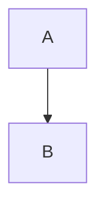

# Markdown Syntax Supported

## Scope
Markdown features supported in mdman. Based on GitHub Flavored Markdown (GFM) plus extensions for Mermaid and KaTeX. Source: `frontend/src/lib/markdown.ts` pipeline (remark/rehype).

## Core GFM Features

| Feature | Syntax | Example |
|---|---|---|
| Headings | `#`–`######` | `# H1` |
| Bold | `**text**` | **bold** |
| Italic | `_text_` | _italic_ |
| Strikethrough | `~~text~~` | ~~strikethrough~~ |
| Inline code | `` `code` `` | `code` |
| Code blocks | ```` ```lang` ... ```` | syntax highlighted |
| Blockquotes | `> text` | > quote |
| Horizontal rule | `---` | --- |
| Links | `[text](url)` | [link](url) |
| Images | `` |  |
| Tables | `| A | B |\n|---|---|\n| 1 | 2 |` | rendered table |
| Task lists | `- [ ]`, `- [x]` | checkboxes |
| Autolinks | `https://example.com` | auto-linked |
| Emphasis nesting | `**_bold italic_**` | **_bold italic_** |

## Extensions

### Mermaid Diagrams

- Fenced block with `mermaid` tag.
- Renders in **preview** only.
- See [Mermaid Diagrams](../concepts/mermaid-diagrams.md).

### KaTeX Math
- Inline: `$E = mc^2$`
- Block: `$$\\int_{-\\infty}^{\\infty} e^{-x^2} dx = \\sqrt{\\pi}$$`
- See [KaTeX Math](../concepts/katex-math.md).

### Footnotes (Not Supported)
- `[^1]` syntax not rendered.

### Definition Lists (Not Supported)
- `Term: Definition` not rendered.

### Sub/Superscript (Partial)
- Subscript: `H~2~O` → H₂O (via KaTeX in math mode).
- Superscript: `x^2^` not in core; use `$x^2$`.

### Strikethrough (GFM)
- `~~text~~` → ~~text~~.

### Table Alignment
| Left | Center | Right |
|:---|:---:|---:|
| a | b | c |

### HTML (Sanitized)
- Raw HTML in Markdown is escaped (security).
- Only whitelisted tags/attributes via rehype-sanitize (not configured; default escapes).

## Syntax Highlighting
- Code blocks: specify language after ``` (e.g., ```python).
- Uses highlight.js with GitHub Dark/Light theme.
- Supported languages: 190+ (see highlight.js docs).

## Editor Features
- Live preview (50 ms debounce).
- Syntax highlighting in **editor** (CodeMirror).
- Auto-completion for Markdown syntax.
- Section-based scroll sync.

## Limitations
- No custom remark/rehype plugins.
- No front matter (YAML/TOML) rendering.
- No custom container syntax (`:::note`).
- Mermaid/Math only in **preview**.

## Related Topics
- [Write and Format Markdown](../tasks/write-format-markdown.md)
- [Work with Diagrams](../tasks/work-with-diagrams.md)
- [Work with Math](../tasks/work-with-math.md)
- [Concept: Mermaid Diagrams](../concepts/mermaid-diagrams.md)
- [Concept: KaTeX Math](../concepts/katex-math.md)