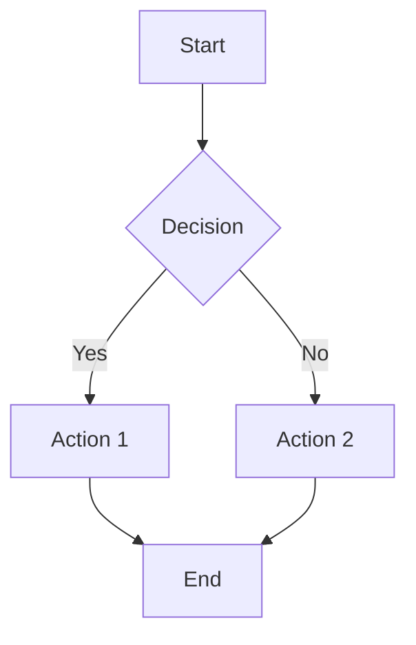
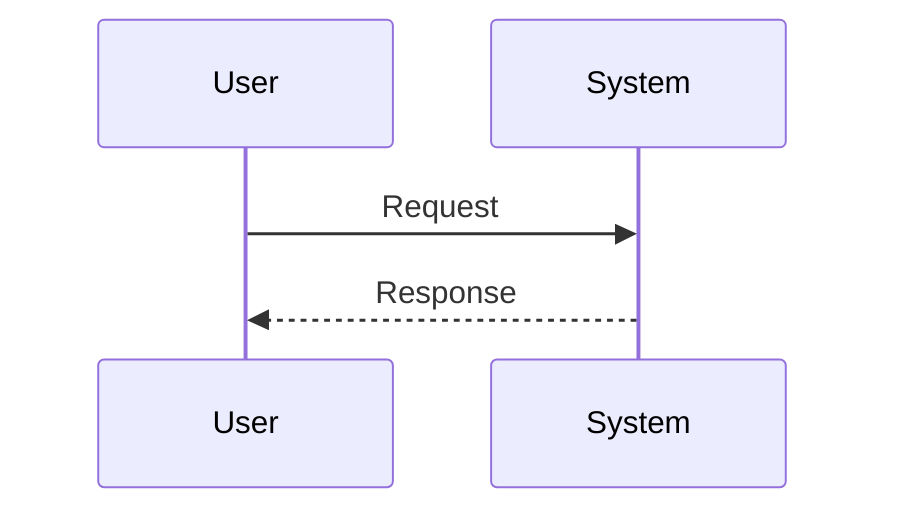
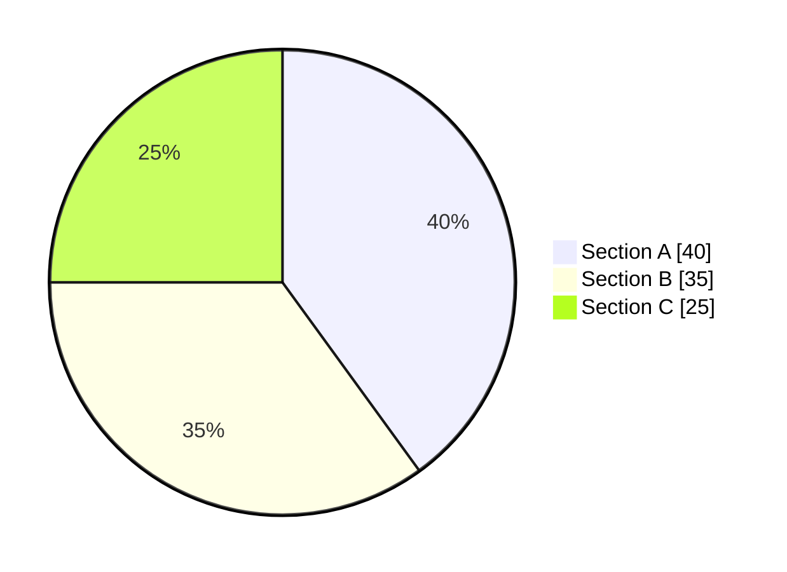

# Work with Diagrams

## Goal
Insert, edit, and render Mermaid diagrams in **notes**.

## Prerequisites
- A **note** is open in the **editor**.
- **Preview** pane is visible.

## Procedure

### Insert a Diagram
1. Place cursor on a blank line in the **editor**.
2. Open **More Options** menu in **toolbar** (three dots).
3. Select **Insert Diagram** → choose type:
   - **Basic Diagram**: Simple flowchart template.
   - **Flowchart**: Top-down flowchart template.
   - **Sequence Diagram**: Sequence diagram template.
   - **Pie Chart**: Pie chart template.
4. A fenced code block with `mermaid` tag and template content appears.
5. Edit the diagram syntax inside the block.

### Edit a Diagram
1. Locate the ````mermaid` ... ```` block in the **editor**.
2. Modify the syntax. The **preview** updates live.
3. Use **editor** syntax highlighting (Mermaid keywords colored).

### Common Diagram Patterns

#### Flowchart (Top-Down)


#### Sequence Diagram


#### Pie Chart


### Copy Diagram Source
1. In **preview**, hover the rendered diagram.
2. Click **Copy code** button (top-right of code block).
3. Mermaid source copies to clipboard.

### Print Diagrams
1. Click **Print** in **toolbar** (`Ctrl+P`).
2. Diagrams render in light theme for print clarity.
3. SVG scales to page width.

## Expected Result
- Diagram renders in **preview** as SVG.
- **Editor** shows syntax-highlighted source.
- Changes reflect in **preview** within 50 ms.

## Verification
- Verify **preview** shows diagram (not error message).
- Verify **TOC** does not list Mermaid code block headings.
- Verify print output includes diagram.

## Recovery / Common Errors

| Error / Situation | Cause | Corrective Action |
|---|---|---|
| `Error rendering diagram` in **preview** | Invalid Mermaid syntax | Check syntax at [Mermaid Live Editor](https://mermaid.live); fix in **editor** |
| Diagram not updating | Large file, debounce delay | Wait 50 ms; check **Sync Scroll** |
| Diagram cut off | SVG exceeds container | Add `%%{init: {'theme': 'base', 'themeVariables': { 'fontSize': '12px'}}}%%` at top |
| Colors wrong for theme | **Preview theme** mismatch | Change **Preview theme** in **Settings**; diagram adapts |

## Limitations
- **Editor** does not validate syntax; only **preview** shows errors.
- No diagram-specific shortcuts (use **toolbar** menu).
- Complex diagrams (>50 nodes) may lag in **preview**.

## Related Topics
- [Concept: Mermaid Diagrams](../concepts/mermaid-diagrams.md)
- [Write and Format Markdown](../tasks/write-format-markdown.md)
- [Troubleshooting: Diagrams Not Rendering](../troubleshooting/diagrams-not-rendering.md)
- [Reference: Markdown Syntax Supported](../reference/markdown-syntax.md)